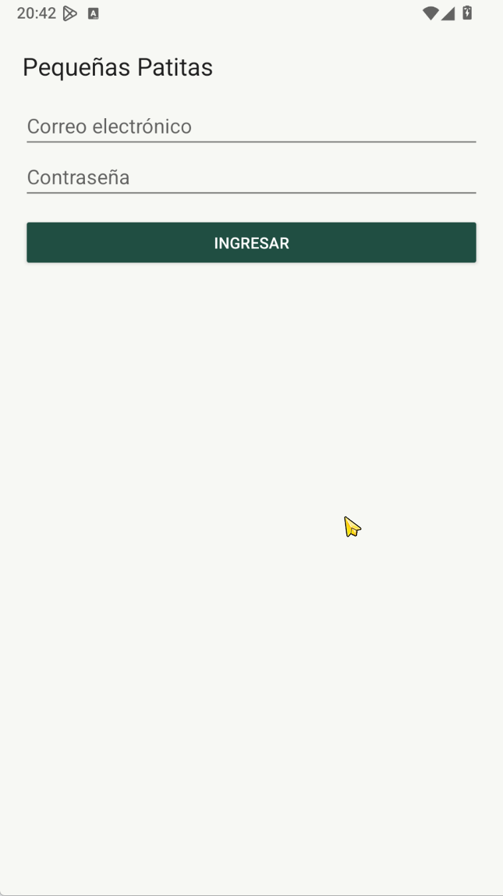
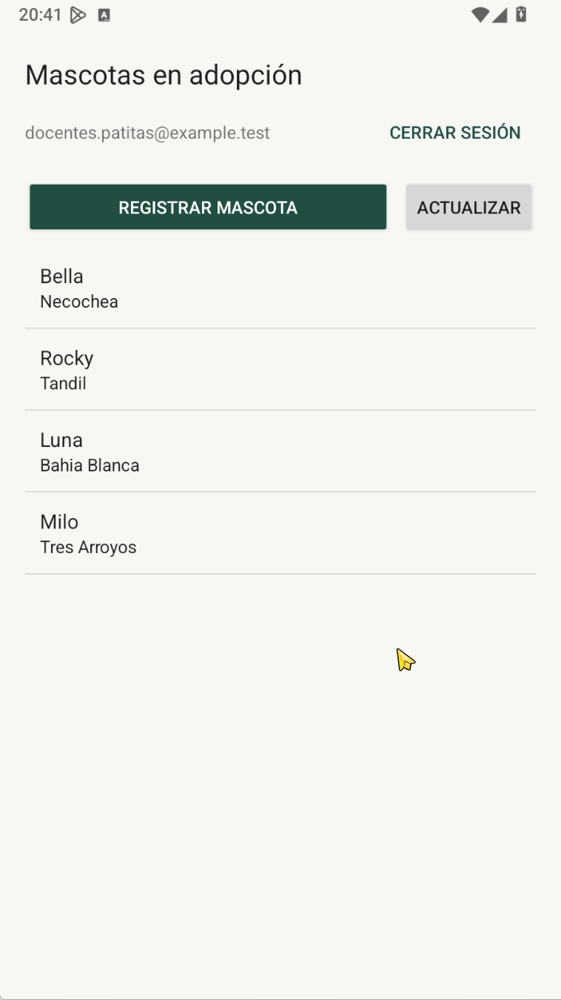

# Pequeñas Patitas para Android

Aplicaciones Móviles y Cloud Computing · TP Integrador 2 · Grupo 21

Nicolás Doladé y Zoe Bellusci

Desde la app se pueden consultar y registrar mascotas en adopción. Las altas quedan en el mismo catálogo que muestra el sitio web.

- [Sitio web](https://pequenas-patitas-production.up.railway.app/)
- [API del TP1](https://pequenas-patitas-production.up.railway.app/api/mascotas.php)

## Cómo correrla

1. Abrí la carpeta `android` en Android Studio.
2. Usá JDK 17 o 21 para Gradle e instalá el SDK de Android 36.
3. Copiá `google-services.json` a `android/app/` siguiendo los pasos de Firebase de abajo.
4. Elegí un emulador o conectá un teléfono con Android 7 (API 24) o superior, y ejecutá `app`.

En Windows también podés compilar con `.\gradlew.bat assembleDebug`. La APK queda en `app/build/outputs/apk/debug/app-debug.apk`. Probamos la app en Android 14.

## Pantallas y API

| Pantalla | Uso | Pedido |
|---|---|---|
| Ingreso | Pide correo y contraseña. Si ya hay una sesión, abre el catálogo. | Firebase Authentication |
| Listado | Muestra el catálogo y la cuenta activa. Desde acá se abre el alta, el detalle o se cierra sesión. | `GET /api/mascotas.php` |
| Alta | Pide nombre, contacto y, si se conoce, ciudad. Al guardar, vuelve al listado y lo actualiza. | `POST /api/mascotas.php` |
| Detalle | Al tocar una ficha, recibe su ID por un extra del `Intent` y muestra sus datos. | `GET /api/mascotas.php?id={id}` |

La URL base está en [`ApiCliente.java`](app/src/main/java/ar/edu/upso/pequenaspatitas/api/ApiCliente.java). Los métodos de la API están en [`MascotasApi.java`](app/src/main/java/ar/edu/upso/pequenaspatitas/api/MascotasApi.java).

| Ingreso | Listado con sesión iniciada |
|---|---|
|  |  |

## Firebase Authentication

El proyecto del grupo es [`pequenas-patitas-upso-g21`](https://console.firebase.google.com/project/pequenas-patitas-upso-g21/overview). La app está registrada con el paquete `ar.edu.upso.pequenaspatitas`.

1. Descargá `google-services.json` desde **Configuración del proyecto → Tus apps** y copialo en `android/app/`. El archivo queda fuera del repositorio.
2. El proveedor **Correo electrónico/contraseña** se configura en **Authentication → Método de acceso**. Las cuentas para entrar se administran en la pestaña **Usuarios**.

Firebase recibe el correo y la contraseña para iniciar sesión. El catálogo sigue en la API PHP del TP1, que recibe los datos de las mascotas. La sesión controla el acceso a las pantallas de Android. Las cuentas de prueba se comparten por el campus.

## Decisiones de diseño

Usamos Retrofit y Gson para hacer los pedidos fuera del hilo de la interfaz y convertir las respuestas JSON a objetos Java. El `ViewModel` guarda el estado de una solicitud al girar la pantalla. Durante un alta, el botón Guardar se deshabilita hasta recibir la respuesta.

La app valida nombre y contacto antes de enviar. Si la API responde con un error, muestra su mensaje. Si se corta la conexión durante un alta, pide revisar el listado antes de volver a guardar.

## Alcance actual

La app permite consultar y dar de alta. Para editar o retirar una ficha se usa la web.
